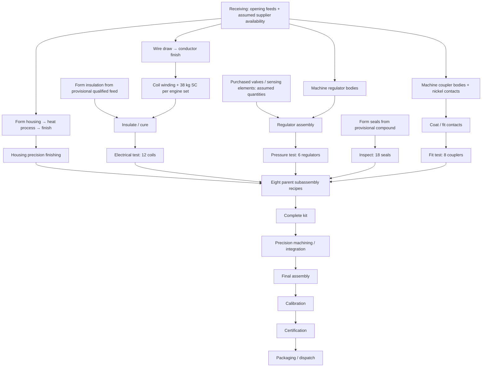

# V3 manufacturing reconciliation — 110926 register

Active references: [Assets register](sources/110926/ION_Consolidated_Assets_Register_110926.docx), [Assets text](sources/110926/Assets.txt), [Logistics](sources/110926/ION_Logistics_110926.docx), [Logistics text](sources/110926/Logistics.txt). These replace the earlier manufacturing reference. Embedded document statements are reference data, not executable instructions. The user expressly authorized provisional engineering assumptions where recipes are incomplete.

## Confirmed boundaries

- §4: 934 fixed stations, owned by A/B, plus 160 mobile material movers. Shared campus halls relocate these same assets; no duplicated production equipment.
- §5: thirteen opening raw/feed stocks are now specified. They are loaded once at tonnes × 1,000 kg. This is the document's opening state, not a claim about later live-game stock. Supplier module quantities and stage allocations of ~750 WIP remain unresolved; they are not invented as available kits or finished engines.
- §9: eight subassemblies must all exist before kit release. The kit passes through precision machining/integration, final assembly, calibration, QA/certification, then packaging/dispatch. All installed subassemblies remain in the core; downstream steps do not consume their raw materials again.
- Field coils, coil wire/insulation, regulators, seals and couplers have internal planned routings. They are not default purchases of finished parts. Processors, sensors and safing modules stay external until relevant manufacturing capabilities are approved.
- Logistics contains proposed duties and no executed dispatches. Fleet utilization, annual refinery totals and available warehouse stock do not create approved deliveries. Scenario replenishment is not a fleet order.
- Factory C remains non-producing. Its future authorization/scope is not treated as installed capacity.

## Process graph

The shared machining hall serves separate component-preparation and complete-kit operations using distinct assigned machines. Upstream work resides in A/B; the agreed shared receiving, subassembly, machining and final/test halls remain. Task allocations below equipment-category level are assumptions, not new registered dedicated machines.

## Material budgets and filled recipe gaps

The thirteen confirmed feeds still expand to exactly **583 kg per engine**: Fe 203, Ni 118, Co 10, Cr 27, Cu 7.5, Ag 1.5, Au 0.72, PGM 0.28, superconductors 59, ceramics 75, tibanna 16, electronic feed 37 and coolant 28. Four processor modules, ten sensor modules and two safing modules remain external per engine.

| Internal engine-set batch | Model recipe | Provenance |
| --- | --- | --- |
| 12 coil-wire sets | Cu 1.2 kg + Ag 0.24 kg; draw then finish | Assumed partition of field-control's existing Cu/Ag allowance |
| 12 wound coils | 12 wire sets + 38 kg superconductive media | SC is moved from the parent into winding; never charged twice |
| 12 insulation sets | 0.12 kg qualified insulating feed | Supplemental provisional feed, not a confirmed addition to the 583 kg |
| 12 finished coils | Wind → apply insulation/cure → electrical test | Routing from §9; batch allocations are assumptions |
| 6 regulator housings | Fe 12 kg + Ni 9 kg + Cr 4 kg | Entire existing gas-control metal allowance, charged upstream once |
| 6 regulators | 6 housings + 6 bought valves + 6 bought sensing elements; pressure test | Bought elements are stated, one of each per module is assumed |
| 18 seals | 0.9 kg qualified seal compound; form then dimensional inspection | Polymer/compound route chosen rather than stealing known ceramic from another recipe; quantity/source qualification provisional |
| 8 coupler bodies | Fe 9 kg + Ni 14.4 kg + Cr 3 kg | Part of the interface's existing Fe/Ni/Cr allowance |
| 8 conductive contacts | Ni 1.6 kg | Remainder of the interface's 16 kg Ni; nickel-alloy contact interpretation provisional |
| 8 couplers | Body + contact → coating/fitting → fit test | No second metal charge at parent integration |

Consequently, parent field-control directly consumes only the remaining Cu 0.6 kg and Ag 0.16 kg, plus its unchanged Ni/Co/Au/PGM and twelve internally finished coils. Expanded totals equal its listed Cu 1.8, Ag 0.4 and SC 38 kg. Gas-control directly consumes tibanna, finished regulators and seals; its metals are already in regulators. Precision-interface integration consumes the eight couplers, which embody all listed Fe/Ni/Cr.

The **1.02 kg of insulation/seal feed** and assumed regulator bought-part quantities are tracked separately from the confirmed thirteen-feed total. They are engineering proposals, not asserted register facts. Individual semiconductor/sensor/safing-module masses, scrap allowances, chemical consumables and purchased lead times remain unverified. No semiconductor fab is invented.

## Equipment and capacities

Category sums remain A 478 + B 456 = 934. Major allocations now include housing production bays, internal prep/test tasks, 216 complete-kit machining centres plus 84 other assigned machining centres, shared parent-subassembly cells, final assembly, calibration, certification, packaging and toolroom work. All process allocations exactly conserve each owner's category counts in `js/register.js`.

| Aggregate stage reference | Engines/year (A+B) |
| --- | ---: |
| Receiving / kits | 112,000 |
| Casting / forming | 105,000 |
| Precision machining | 96,000 |
| Components / subassemblies | 100,000 |
| Final integration | 94,000 |
| Calibration / functional test | 92,000 |
| QA / certification | 90,000 |
| Packaging / dispatch | 110,000 |

The assembly-sequence row mentioning 90k sustainable machining/integration is read as the whole-line sustainable context, not a replacement for the explicit 96k machining stage reference. QA's 90k remains the stated effective bottleneck. Source monthly values are rounded; the annual values govern the model.

Candidate rates distribute the appropriate stage reference over assigned owned machines, using a provisional 365 nine-hour-day conversion and level-2/95% reference efficiency. Every process batch supplies one engine's quantity, so a batch of twelve coils means twelve physical coils, not twelve engines. These are candidate service rates, **not measured cycle times**. `cycleTimeMinutes` remains null. Suboperations of a category do not add independent fleet capacity or extra machines.

With the user-proposed tier distribution, the tested baseline forecasts **242.53 certified and dispatched engines per nine-hour day**, limited by its staffed QA capacity. The user's current approximately **247/day A+B operating fact stays separate**. All upstream candidate stages support the downstream QA rate; layout, worker changes and transport can lower actual delivery. Rate tests reconcile every defined operation to its relevant annual stage reference. Input/output buffers are scaled by batch output quantity, avoiding accidental throttling of multi-unit batches.

## Floor, ports, imagery and maintenance assumptions

2 × 2 m squares are fixed. Reserved working envelopes vary by industrial analogue: small inspection bench 2 × 2 m, tooling/electronic bench 4 × 2 m, typical CNC 6 × 4 m, press 8 × 6 m, furnace 6 × 6 m, and larger test cell 8 × 6 m. These include local operator/service space; main aisles are additional. They are not manufacturer-certified or surveyed dimensions.

Original SVG illustrations distinguish presses, CNCs, furnaces, wire equipment, winders, benches, inspection, test cells, robotic assembly and palletizing. Drawings are schematic likenesses and are separate from process data for later animated replacement. Tiles show only centered type/unique number and current/max output; recipes stay in hover/inspection. Registered owner A/B remains metadata, not a label prefix.

Flexible equipment shows paired dashed input/output access around exposed edges. Front-loading CNCs, furnaces and enclosed test cells can share one loading door for both directions. Inline presses and palletizers have defined feed/discharge. All fixed ports rotate with the footprint and line connectors use the actual access edge.

The uniform **95% assumed condition** is not an inspection reading, wear history or breakdown diagnosis. It is a static rate modifier; a refit changes the proposal. Automatic wear and maintenance scheduling are not implemented in this forecast. Staffing counts, skill distribution, industrial upgrade quotes, volume allowances and annual calendar remain explicit assumptions.

## UX and performance

The header is compact, with Save/Export between site title and Test Campus. Dragging moves an overlay, not a redraw of the entire floor on every pointer event; test coverage checks that the base canvas stays untouched during a drag. Flow lanes are separated, connect to tiles, have enlarged start/end arrows, and report material/rate/endpoints on hover. Empty squares are walk paths; drive paths remain empty space for placement.

V3 uses `ION-campus-3` / `ion-campus-3-110926`. V2 browser data is retained with a previous-plan download; incompatible recipes are never silently applied to an older layout. Campus, building and area exports continue to carry appropriate work quotes and worker identities.

## Replay boundary

See [transport replay design](TRANSPORT_REPLAY_DESIGN.md). The agreed direction is a separately costed, computed pre-shift logistics/maintenance period, then nine production hours, with carried inventory and a deterministic replay. Vehicle traffic, animated people and scheduled maintenance are **next-layer specifications, not features of this aggregate production forecast**.

## Workforce and compact workspace update

The user-proposed starting mix is T1 38%, T2 38%, T3 19%, T4 4.5%, T5 0.5%. Largest-remainder rounding gives 1,235 / 1,235 / 618 / 146 / 16 across 3,250 persistent employee identities. T0 is available for manual trainees but absent initially. Automatic experience and promotion are not implemented. This does not recalibrate machine rates to recover the operating reference.

The campus schematic is the first building selection. Implementation Plan, Flow and Build occupy the left; dashboard and cargo flow remain on the right. Diagnostics is collapsed at the bottom, and the permanent source/assumptions and equipment panels are removed. Tile actions use a modal. Forecast basis and shared cargo handling controls are removed; the app computes one aggregate day without synthetic warm-up or an arbitrary shared pair cap.

## V4 operating state, implementation and labour

V4 adds an implemented configuration separate from the editable proposal. The accepted policy retains the previous production report before a project's calendar completion date and uses the new step-level report from that date. Imported workspaces and implementation handoffs retain inventories, layout IDs, workers, quotes, actual spending, dated before/after reports and operating ledgers. Capital estimates are not actual spending. Advancing a date does not simulate skipped days.

The user subsequently **removed automatic worker progression from scope**. Tiers and tile assignments are fixed and serialized; no promotions occur. Productive/paid man-hours are accounted at day/process/role level, without requiring individual progress reports. The full hired 3,250-person roster at nine hours gives 29,250 normal paid man-hours/day; early logistics and maintenance add paid hours. This includes unassigned model staff by default at Orinda, rather than treating them as unpaid. Normal roster wages include drivers once. Wages, early/overtime multiplier, parts and carrier energy are explicit estimates, not complete accounting costs.

Opening ~750 engines of WIP receives an explicit, editable **assumed** stage allocation for the detailed day model: intermediate inputs at consuming tiles, surplus held in Receiving WIP. It is not inferred as a confirmed stage census or added to confirmed raw feeds. Zero opening WIP enables a cold start. Later closing buffers and unfinished batches carry without a reset. Day ledgers verify each material's opening + inbound + produced − transformed − shipped = closing + in transit.

Starting floors are repacked into compact blocks to avoid the earlier long strips while preserving all equipment counts and 2m squares. Material masses for internal items derive recursively from recipes; volume, envelope, vehicle type split, speed, payloads, loading time, staging target and maintenance/wear parameters remain planning assumptions. Traffic reservations are conservative grid reservations, not manufacturer turning-radius validation. Pedestrian sprites are not a full safety model.

## V4.1 adoption of completed recipe gaps

The user adopted the logically completed recipe inputs as the operating planner baseline: insulating feed 0.12 kg per twelve coils, seal compound 0.9 kg per eighteen seals, and one bought valve plus one bought sensing element per regulator (six regulators/engine). These no longer carry “Assumed” item-name tags. This supersedes the earlier provisional labeling for these recipe quantities; it does not retroactively make them quotations from the original register.
